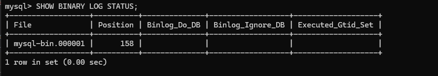
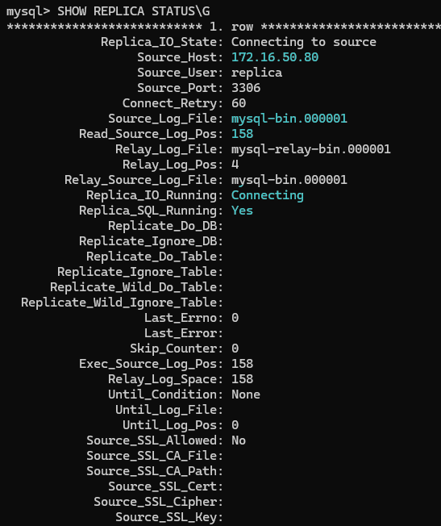
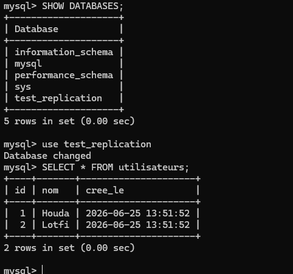
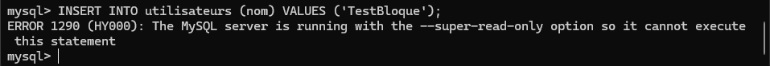

# Procédure de Déploiement : Réplication MySQL Master-Slave

## 1. Architecture


|Nom de la VM| Adresse IP  | Rôle MySQL     |Mode d'Écriture      |Port |
| --------   | --------    | --------       |-------------        |-----|
| db-master  | 172.16.50.80| Source (Master)|Lecture/Écriture (RW)|3306 |
| db-slave   | 172.16.50.81| Replica (Slave)|Super Read-Only (RO) |3306|

## 2. Installation Initiale (Sur les deux VMs)
Mise à jour des dépôts du système et installation du paquet officiel du serveur MySQL :

```
sudo apt update
apt upgrade -y
apt install mysql-server -y
```
## 3. Configuration du Serveur Master (172.16.50.80)
### 3.1 Fichier de configuration du Master
Modifier le fichier principal de configuration `/etc/mysql/mysql.conf.d/mysqld.cnf` :
 
```
[mysqld]
# Liaison sur l'interface réseau
bind-address            = 172.16.50.80

# Identifiant unique du serveur (Obligatoire pour la réplication)
server-id               = 1

# Activation du Binary Log (contient les modifications à répliquer)
log_bin                 = /var/log/mysql/mysql-bin.log
binlog_format           = ROW

# Sécurité & Robustesse
sync_binlog             = 1
innodb_flush_log_at_trx_commit = 1
```
   

### 3.2. Initialisation de l'utilisateur de réplication
```
systemctl restart mysql 
 
mysql -u root

# Création de l'utilisateur dédié à la réplication pour le Slave

CREATE USER 'replica'@'172.16.50.81' IDENTIFIED BY 'erty123';
GRANT REPLICATION SLAVE ON *.* TO 'replica'@'172.16.50.81';
FLUSH PRIVILEGES;
```


## 4. Configuration du Serveur Slave (172.16.50.81)
### 4.1. Fichier de configuration du Slave
Modifier le fichier de configuration `/etc/mysql/mysql.conf.d/mysqld.cnf` sur l'instance Slave :
 
```
[mysqld]
bind-address            = 172.16.50.81

# L'ID doit être UNIQUE et différent du Master
server-id               = 2

# Protection absolue contre les écritures accidentelles (y compris root)
read_only               = 1
super_read_only         = 1

# Relais de logs
relay_log               = /var/log/mysql/mysql-relay-bin.log
```
### 4.2. Activation et raccordement au Master 
Lancer le processus de réplication au sein de l'instance MySQL du Slave :
```
systemctl restart mysql

mysql -u root

CHANGE REPLICATION SOURCE TO
SOURCE_HOST='172.16.50.80',
SOURCE_USER='replica',
SOURCE_PASSWORD='erty123',
SOURCE_LOG_FILE='mysql-bin.000001', 
SOURCE_LOG_POS=158;


START REPLICA;
```

## 5. Validation et Tests de Robustesse 
### 5.1. Vérification du statut de réplication (Sur le Slave)
`SHOW REPLICA STATUS\G`



Indicateurs nominaux obligatoires à valider :
**Replica_IO_Running:** Yes — La connexion réseau et le suivi des logs Master sont actifs.
**Replica_SQL_Running:** Yes — L'application des requêtes répliquées s'exécute correctement.
**Last_IO_Error:** (Vide, aucun message d'erreur).

### 5.2. Test de transmission de données
Validation fonctionnelle en créant un jeu de données sur le Master :

```
CREATE DATABASE test_replication;

USE test_replication;

CREATE TABLE utilisateurs (
    id INT AUTO_INCREMENT PRIMARY KEY,
    nom VARCHAR(50),
    cree_le TIMESTAMP DEFAULT CURRENT_TIMESTAMP
);

INSERT INTO utilisateurs (nom) VALUES ('Houda'), ('Lotfi');
```

Contrôle de conformité immédiat sur le Slave :
```
USE test_replication;
SELECT * FROM utilisateurs;
```


### 5.3. Test de Sécurité (Validation du Mode Read-Only)

Ce test permet de vérifier que le serveur Slave bloque bien toutes les écritures pour éviter de désynchroniser la base de données.

Tentez une insertion manuelle directement sur la console MySQL du Slave (172.16.50.81) :
```
USE test_replication;
INSERT INTO utilisateurs (nom) VALUES ('TestBloque');
```
**Résultat attendu :**
Le serveur doit immédiatement bloquer la requête et afficher l'erreur suivante :


**Résultat du test :** CONFORME (OK) 
**Conclusion :** La sécurité fonctionne. Aucune écriture accidentelle n'est possible sur le Slave.